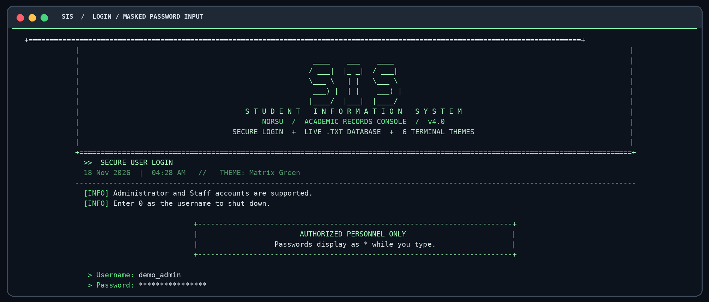
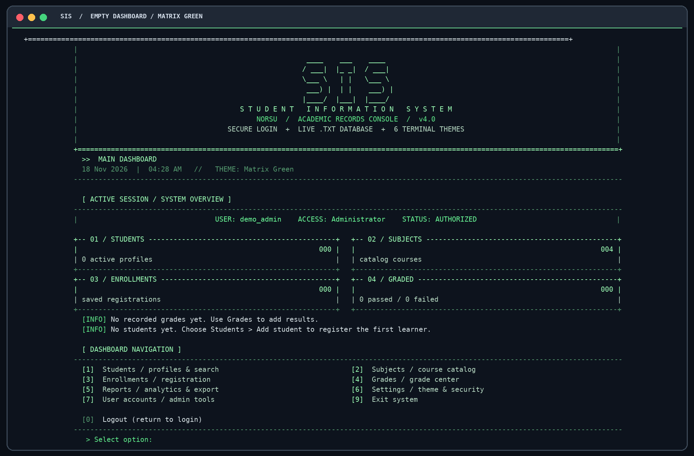
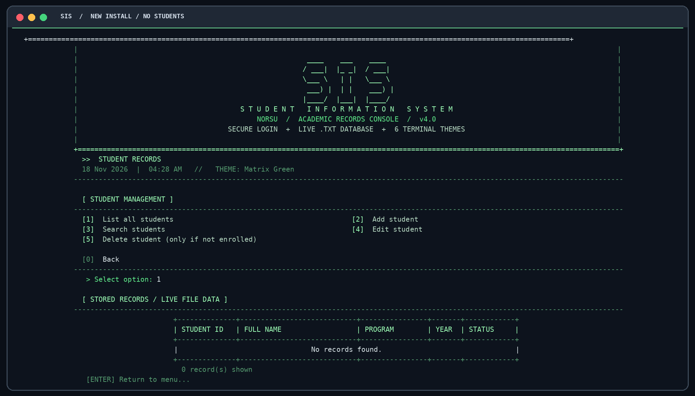
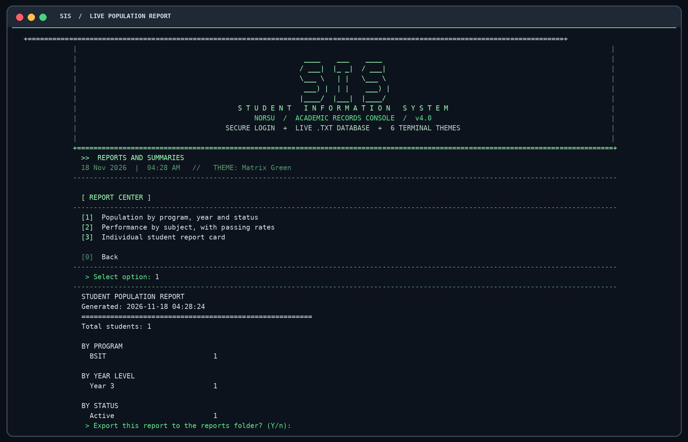
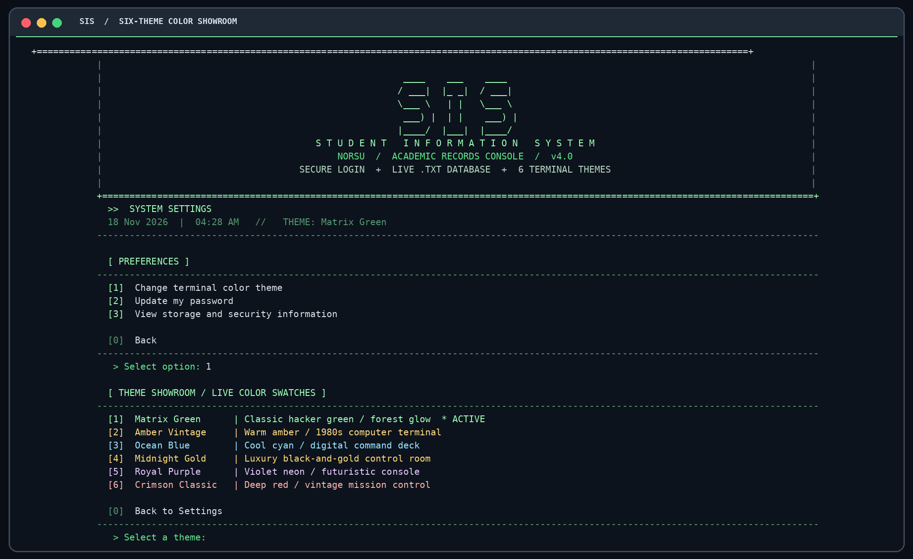

# Student Information System

**Python Final Laboratory Project — Terminal-Based Management System**

## About Our project

For our final project, we chose a **Student Information System**. The main purpose of the program is to keep student information organized instead of writing everything manually. It runs in the terminal, and it saves the information in `.txt` files so that records are still there after I close the program.

The system can manage **students, subjects, enrollments, and grades**. It also has a login, reports, and terminal color themes. I kept the design like an old-school computer system with menus, borders, and a centered dashboard.

## Main features

- **Login and logout:** Administrator and Staff accounts. Passwords are hidden with `*` while typing.
- **Student records:** The Administrator can add, edit, delete, list, and search students. Staff can only list and search student profiles.
- **Subjects:** Keep a list of subjects with codes, titles, units, and instructors.
- **Enrollments:** Connect a student to a subject and prevent duplicate enrollments.
- **Grades:** Enter prelim, midterm, and final exam scores and calculate the result.
- **Reports:** View a student population report, subject performance report, and individual report card. Reports can also be saved as `.txt` files.
- **Design and settings:** Six selectable color themes, a centered dashboard, and a password-change option.
- **File handling:** Read, append, and update text files. The program checks user input and handles file errors.

## Requirements

- Python **3.9 or newer**
- A terminal such as Windows PowerShell, Command Prompt, VS Code Terminal, macOS Terminal, or Linux Terminal
- No extra Python packages are needed (standard library only)

## How to run the program

1. Download and extract the project ZIP.
2. Open the `Student_Information_System` folder.
3. Open a terminal in that folder.
4. Run one of these commands:

   **Windows:**
   ```powershell
   py main.py
   ```

   **macOS / Linux:**
   ```bash
   python3 main.py
   ```

   You can also try `python main.py` if that command works on your computer. On Windows, `RUN_WINDOWS.bat` is included as another way to launch the application.
5. The first time you run it, create an Administrator account. Choose a username and a password with at least 8 characters, including a letter and a number.
6. Log in and use the menu numbers to navigate. Use `0` to go back or log out.

**Note:** This version starts with **no student records**. I wanted the Administrator to enter the student information. There are four fictional subjects already listed for testing. Example student records are in the separate `sample_data/` folder; they do not automatically appear inside the system.

## How the text files work

I used text files instead of a database program. The data is inside the `data/` folder:

| File | What it stores |
| --- | --- |
| `students.txt` | Student ID, name, program, year level, email, status |
| `subjects.txt` | Subject code, subject title, units, instructor |
| `enrollments.txt` | Student and subject enrollment information |
| `grades.txt` | Scores, average, and pass/fail remarks |
| `users.txt` | Account details and salted password hashes (created locally) |
| `settings.txt` | Selected terminal theme |

One record is saved on each line as JSON text. This is still a normal `.txt` file. For example, a student record looks like this:

```text
{"student_id":"STU0001","full_name":"Alex Rivera","program":"BSIT","year_level":1,"email":"alex.rivera@example.com","status":"Active","created_at":"2026-11-18 09:00:00"}
```

The program reads records using `TextStore.load()` in `sis/database.py`. New records are added with `TextStore.append()`. When I edit or delete records, `TextStore.save()` saves the updated list safely through a temporary file before replacing the original. This helps prevent losing the original information if a file operation fails.

The four kinds of records are connected: **an enrollment uses a student ID and a subject code**, and grades are linked to an enrollment ID. That is why the program checks that the student and subject exist before saving an enrollment.

## Grade calculation

The example grading rule in this project is:

```text
Average = (Prelim × 0.30) + (Midterm × 0.30) + (Final Exam × 0.40)
```

An average of **75 or higher** is marked **Passed**. Below 75 is **Failed**. This is an example for the final project, not an official university grading rule.

## User roles

| Feature | Administrator | Staff |
| --- | --- | --- |
| View and search student records | Yes | Yes |
| Add, edit, or delete students | Yes | No |
| Manage subjects | Yes | View/search only |
| Manage enrollments and enter grades | Yes | Yes |
| View reports and change themes | Yes | Yes |
| Create or manage user accounts | Yes | No |

Passwords are **not saved as readable text**. The system uses random salts and PBKDF2-HMAC-SHA256 password hashing in `sis/security.py`.

## Project files

```text
Student_Information_System/
├── main.py                Starts the application
├── sis/
│   ├── app.py             Menus and user interaction
│   ├── database.py        Reading, appending, and saving .txt records
│   ├── password_input.py  Shows * when typing passwords
│   ├── security.py        Password hashing and verification
│   ├── service.py         Students, subjects, enrollments, grades, reports
│   └── terminal.py        Terminal colors, menus, tables, and layout
├── data/                  Live text files used by the system
├── sample_data/           Fictional examples for checking file formats
├── screenshots/           Login, dashboard, file operations, reports, themes
├── tests/                 Automated checks
├── reports/               Reports exported when the program runs
├── RUN_WINDOWS.bat
├── RUN_MAC_LINUX.sh
├── requirements.txt
└── README.md
```

I separated the Python code into files so it would be easier to find the parts for the menu, storage, security, and main features.

## Terminal themes

The system has these choices: **Matrix Green, Amber Vintage, Ocean Blue, Midnight Gold, Royal Purple,** and **Crimson Classic**. The chosen theme is saved in `data/settings.txt` and loaded again when the program restarts. For the wider centered layout, I recommend maximizing the terminal window.

## Screenshots

The `screenshots/` folder contains pictures of the login, dashboard, file operations, record tables, reports, and theme settings. They were captured from example sessions with fictional data. My actual project starts without saved students.







## Testing

I can run the included tests from the project folder with:

```bash
python -m unittest discover -s tests -v
```

These tests check account access, data validation, file handling, the student-related records, reports, and theme settings. It is also important to test the features by actually running the program in the terminal.

